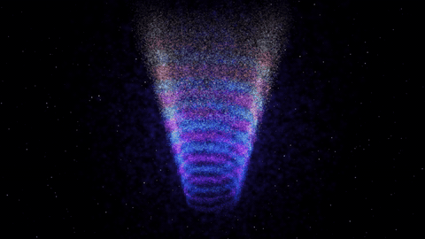

# Fibonacci Helix Nebula

A real-time, interactive double-helix nebula built from the golden angle (137.5°), rendered on the GPU with Python.



Full-quality clip: [assets/preview.mp4](assets/preview.mp4)

## Features

- **200,000 particles** whose positions are computed on the GPU (GLSL vertex shader)
- **Golden-angle (Fibonacci) disc scatter** that gives the strands their organic, nebula-like density
- **HDR bloom pipeline:** threshold, 3-level separable blur, tone mapping, colour grade, vignette, dither
- **Depth of field** and a twinkling starfield
- **Touch interaction:** click anywhere and nearby particles scatter, then settle back into the helix
- **Free-view camera:** double-click to orbit, zoom, and jump to top, bottom, front and side views
- **Seamless 24-second loop**, exportable to MP4 at up to 1080p60

## Install

Requires Python 3.10+ and a GPU with OpenGL 3.3 support.

```bash
python -m venv venv
venv\Scripts\activate          # Windows
# source venv/bin/activate     # macOS / Linux
pip install -r requirements.txt
```

## Run

```bash
python nebula_bloom.py
```

| Action | Result |
|---|---|
| Click | Scatter particles around the cursor |
| Double-click | Toggle free view (and back to the cinematic camera) |
| Drag (free view) | Orbit to any angle |
| Scroll (free view) | Zoom |
| `1` `2` `3` `4` `5` | Top, bottom, front, side, diagonal |
| `R` | Return to the cinematic camera |
| `Esc` | Quit |

## Export a video

```bash
python export_video.py
```

Set `QUICK_TEST = False` in `export_video.py` for the full 1080p60 loop. Rendering is frame-by-frame at fixed time steps, so the video is smooth even if your GPU can't run it live in real time. Interaction effects are for the live window only, so exports use the cinematic camera.

## Tuning

The settings at the top of `nebula_bloom.py` control the look: `BLOOM_STRENGTH`, `EXPOSURE`, `BRIGHTNESS`, `DOF_STRENGTH`, `PUSH_IN`, `DUST`, `TOUCH_RADIUS`, `TOUCH_STRENGTH`, and particle counts.

## How it works

1. **Math:** each strand is a parametric helix, `x = r cos θ`, `y = r sin θ`, with a cloud around it whose points are spread by the golden angle.
2. **Animation:** the vertex shader recomputes every position from a time value, so Python only sends one number per frame.
3. **Looks:** particles are drawn additively into a 16-bit float texture, blurred at three scales, added back, then tone-mapped.
4. **Looping:** every motion completes a whole number of cycles per 24 seconds, so the loop has no visible seam.

## Project structure

```
nebula_bloom.py    live window, shaders, interaction
export_video.py    offline frame-by-frame MP4 renderer
assets/            preview GIF and video
requirements.txt
```

## Tech

Python, NumPy, ModernGL, pyglet, imageio-ffmpeg, GLSL.
